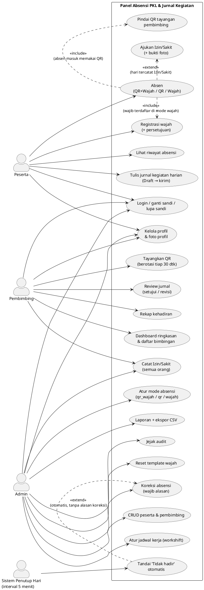
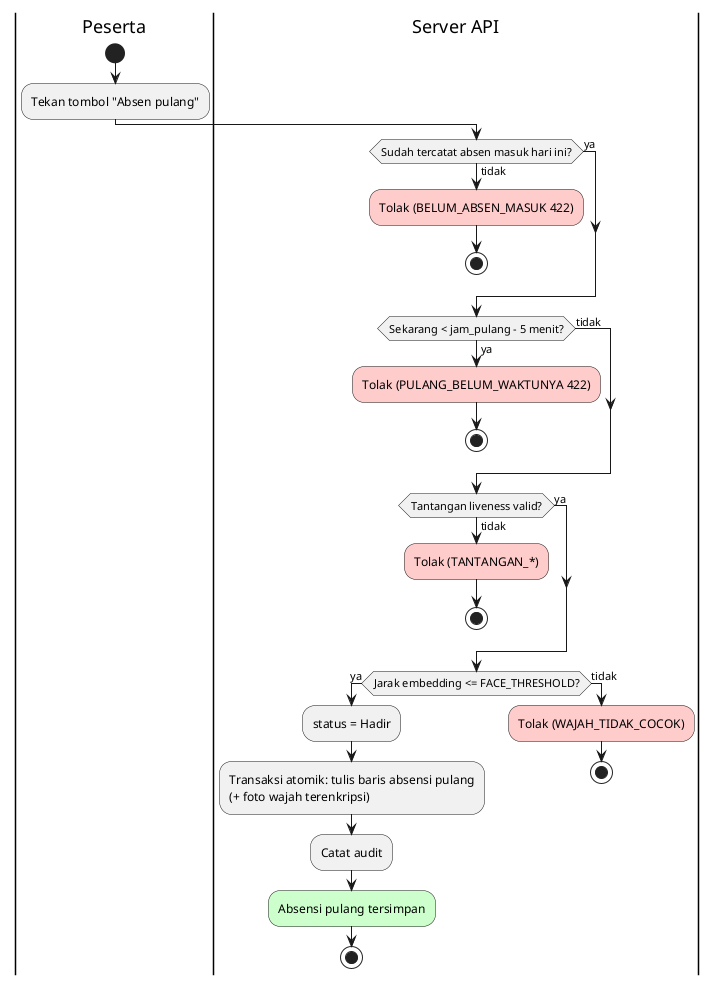

# Diagram Konsep Sistem

## Panel Absensi PKL dan Jurnal Kegiatan — Astakira Media
Basis: `docs/perancangan-sistem.md`, `backend/src/models/index.js`, dan migrasi `backend/migrations/`.
Ketiga diagram ditulis dalam **PlantUML** — render lewat ekstensi PlantUML (VS Code/IntelliJ) atau https://www.plantuml.com/plantuml .

---

## 1. Use Case Diagram

Aktor terlibat:

| Aktor | Keterangan |
|---|---|
| **Peserta** | Siswa/mahasiswa PKL: absen, jurnal, pengajuan Izin/Sakit |
| **Pembimbing** | Menayangkan QR, review jurnal, rekap bimbingan |
| **Admin** | Kelola akun, jadwal, koreksi, laporan, audit |
| **Sistem Penutup Hari** | Pekerjaan interval otomatis (bukan manusia) |



Catatan relasi:

- **`<<include>>` UC4 → UC4a**: alur bawaan mode `qr_wajah` — absen **masuk** selalu melewati QR tayangan pembimbing; sedangkan absen **pulang** tidak menyertakan use case QR (langsung jalur wajah).
- **`<<include>>` UC4 → UC3**: verifikasi wajah wajib template terdaftar; bila admin mematikan mode wajah, relasi ini tidak terpakai (mode `qr`).
- **`<<extend>>` UC4 → UC8**: pengajuan Izin/Sakit hanya dilakukan bila ada hari yang sudah/akan terkunci.
- **Aturan fundamental**: waktu, tanggal, status absensi, dan penulis catatan **selalu ditentukan server** — tidak ada use case bagi peserta untuk mengirim jam/status/user_id.
- Kepemilikan data: peserta hanya melihat miliknya; pembimbing hanya bimbingannya (dipaksakan pada setiap endpoint, bukan use case terpisah).

---

## 2. Activity Diagram (Diagram Aktivitas) — Swimlane

Alur utama: **absen peserta** (masuk via QR+wajah; pulang langsung wajah), dengan
partisi/irisan: Pembimbing, Peserta, Perangkat (kamera), Server API, dan Sistem Penutup Hari.

```plantuml
@startuml
skinparam shadowing false
|Pembimbing|
start
:Buka halaman "Tayangkan QR";

|Server API|
:Buat token tayang (simpan hash SHA-256, TTL 30 dtk);
:kirim token mentah ke pembimbing;

|Pembimbing|
:Tampilkan QR di layar (HP/layar bimbingan);
note right: QR diganti otomatis tiap\nQR_TTL_DETIK (30 dtk)

|Peserta|
:Pindai QR dari HP sendiri;
:kirim token (hasil pemindaian) ke server;

|Server API|
if (Token tayang valid?\n(bimbingan / kedaluwarsa /\nbelum dipakai)?) then (ya)
:Buat baris sementara: hash token,
TTL 120 dtk, terikat jenis "masuk";
else (tidak)
  #FFCCCC:Tolak
  (QR_KEDALUWARSA / QR_SUDAH_DIPAKAI /
  BUKAN_BIMBINGAN);
  stop
endif

:Buat tantangan liveness
(nonce hash sekali pakai + gerakan acak, TTL 60 dtk);

|Perangkat Peserta (kamera)|
:Aktifkan kamera;
:Jalankan instruksi gerakan liveness;
:Ekstrak embedding wajah di browser
(MediaPipe Face Landmarker, 128 dimensi);

|Peserta|
:Kirim embedding + jawaban tantangan;

|Server API|
if (Tantangan liveness valid?\n(nonce sekali pakai, TTL 60 dtk)?) then (ya)
else (tidak)
  #FFCCCC:Tolak (TANTANGAN_*);
  stop
endif

if (Mode wajah aktif?) then (ya)
  :Dekripsi embedding dari face_templates
  (AES-256-GCM, hanya di memori server);
  :Hitung jarak Euclidian
  ke embedding pengajuan;
  if (Jarak <= FACE_THRESHOLD (0,5)?) then (ya)
  else (tidak)
    #FFCCCC:Tolak (WAJAH_TIDAK_COCOK);
    stop
  endif
else (tidak)
  :Mode QR saja - lewati verifikasi embedding;
endif

:Dapatkan waktu zona aplikasi (Asia/Jakarta)
= tanggal + jam saat ini;
:Hitung jenis & status:
  - masuk: Hadir bila jam <= jam_masuk + toleransi_menit,
    selain itu Terlambat
  - pulang: selalu Hadir;

if (Sudah absen jenis ini / hari libur /\nhari tercatat Izin/Sakit?) then (tidak)
else (ya)
  #FFCCCC:Tolak (SUDAH_ABSEN / HARI_LIBUR /
  HARI_TERCATAT);
  stop
endif

:Transaksi atomik:
  - tandai token tayang dipakai
  - tulis baris absensi (+ foto wajah momen absen terenkripsi);
:Catat audit (server menulis
  user_id, tanggal, jam, status, metode);
#CCFFCC:Absensi tersimpan;
stop

|Sistem Penutup Hari|
:Tiap 5 menit pengecekan;
if (Hari kerja & sekarang > jam_pulang + 60 menit?) then (ya)
  :Pilih peserta aktif tanpa catatan absensi apa pun hari ini;
  :Tulis baris "Tidak hadir"
  (jam 00:00:00, metode = Otomatis);
endif
stop
@enduml
```

Catatan aktivitas:

- Pembangkitan token, perhitungan jam/tanggal/status, dekripsi & pembandingan embedding **semuanya di sisi server** — perangkat peserta hanya berkontribusi hasil kamera.
- Dua pemindaian bersamaan → salah satu ditolak 409 `QR_SUDAH_DIPAKAI` (transaksi atomik).
- **Cabang pulang** (diagram terpisah di bawah): masuk jalur wajah langsung **tanpa QR**.
- Slot harian terkunci oleh batas unik DB `uq_absensi_harian (user_id, tanggal, jenis)`: `SUDAH_ABSEN` 409; hari libur → `HARI_LIBUR`; hari tercatat Izin/Sakit → `HARI_TERCATAT`.

Diagram penggantian untuk **cabang pulang** (jalur wajah langsung):



---

## 3. Entity Relationship Diagram (ERD)

16 tabel dari `models/index.js` + migrasi. Konvensi umum: kolom `dibuat_pada` / `diubah_pada` (timestamps) ada di semua tabel, tidak diulang. `audit_log` sengaja **tanpa foreign key** di `user_id` agar jejak tetap ada walau akun dihapus.

```plantuml
@startuml
skinparam shadowing false
hide circle
skinparam linetype ortho

entity "users" as users {
  * id : INT <<PK>>
  --
  * nama : VARCHAR(100)
  * username : VARCHAR(50) <<UK>>
  * email : VARCHAR(120) <<UK>>
  * password_hash : VARCHAR(100)
  * role : ENUM(peserta,pembimbing,admin)
  foto_url : VARCHAR(255)
  * aktif : BOOLEAN
  reset_token_hash : CHAR(64)
  reset_expires : DATETIME
}

entity "peserta" as peserta {
  * id : INT <<PK>>
  --
  * user_id : INT <<UK,FK>>
  divisi : VARCHAR(80)
  pembimbing_id : INT <<FK>>
}

entity "pembimbing" as pembimbing {
  * id : INT <<PK>>
  --
  * user_id : INT <<UK,FK>>
  divisi : VARCHAR(80)
}

entity "workshift" as workshift {
  * id : INT <<PK>>
  --
  * hari : ENUM(Senin..Minggu) <<UK>>
  * hari_kerja : BOOLEAN
  * jam_masuk : TIME
  * jam_pulang : TIME
  * toleransi_menit : INT (bawaan 15)
}

entity "face_templates" as face_templates {
  * id : INT <<PK>>
  --
  * user_id : INT <<UK,FK>>
  * embedding : TEXT (AES-256-GCM, iv.tag.ct)
  disetujui_pada : DATETIME
}

entity "face_verifications" as face_verifications {
  * id : INT <<PK>>
  --
  * user_id : INT <<FK>>
  * jenis : ENUM(masuk,pulang)
  * kedaluwarsa_pada : DATETIME
  dipakai_pada : DATETIME
  foto_ciphertext : MEDIUMTEXT
}

entity "qr_tokens" as qr_tokens {
  * id : INT <<PK>>
  --
  * token_hash : CHAR(64) <<UK>> (SHA-256 saja)
  * user_id : INT <<FK>>
  * jenis : ENUM(masuk,pulang)
  * kedaluwarsa_pada : DATETIME
  dipindai_oleh : INT (FK)
  dipindai_pada : DATETIME
  dipakai_pada : DATETIME
}

entity "token_pembimbing" as token_pembimbing {
  * id : INT <<PK>>
  --
  * pembimbing_id : INT <<FK>>
  * token_hash : CHAR(64) <<UK>> (SHA-256)
  * kedaluwarsa_pada : DATETIME
  dipakai_pada : DATETIME
}

entity "absensi" as absensi {
  * id : INT <<PK>>
  --
  * user_id : INT <<FK>>
  * tanggal : DATE
  * jenis : ENUM(masuk,pulang)
  * jam : TIME
  * status : ENUM(Hadir,Terlambat,Izin,Sakit,Tidak hadir)
  * metode : VARCHAR(30)
  keterangan : TEXT
  token_id : INT (FK, nullable)
  dikonfirmasi_oleh : INT (FK, nullable)
  note : batas unik uq_absensi_harian\n(user_id, tanggal, jenis)
}

entity "absensi_penolakan" as absensi_penolakan {
  * id : INT <<PK>>
  --
  * user_id : INT <<FK>>
  * token_id : INT
  * pembimbing_id : INT <<FK>>
  * alasan : TEXT
}

entity "pengajuan_izin" as pengajuan_izin {
  * id : INT <<PK>>
  --
  * user_id : INT <<FK>>
  * tanggal : DATE
  * jenis : ENUM(Izin,Sakit)
  * status : ENUM(Menunggu,Disetujui,Ditolak)
  * keterangan : TEXT (3..1000)
  * bukti : VARCHAR(72) (uploads/pengajuan/)
  ditangani_oleh : INT (FK)
  catatan_putusan : TEXT
}

entity "wajah_foto" as wajah_foto {
  * id : INT <<PK>>
  --
  * absensi_id : INT <<UK,FK>>
  * data : MEDIUMTEXT (iv.tag.ct base64 JPEG)
}

entity "pengaturan_absensi" as pengaturan_absensi {
  * id : INT <<PK>> (baris tunggal id=1)
  --
  * metode : ENUM(qr_wajah,qr,wajah)
  * liveness_aktif : BOOLEAN
}

entity "tantangan_wajah" as tantangan_wajah {
  * id : INT <<PK>>
  --
  * user_id : INT <<FK>>
  * nonce_hash : CHAR(64) <<UK>> (SHA-256)
  * kode_gerakan : ENUM(kedip,tengok_kiri,tengok_kanan,buka_mulut)
  * kedaluwarsa_pada : DATETIME
  dipakai_pada : DATETIME
}

entity "jurnal" as jurnal {
  * id : INT <<PK>>
  --
  * user_id : INT <<FK>>
  * tanggal : DATE
  * judul : VARCHAR(150)
  * uraian : TEXT
  hasil : TEXT
  kendala : TEXT
  rencana : TEXT
  * status : ENUM(Draft,Dikirim,Revisi,Disetujui)
  note : batas unik uq_jurnal_harian (user_id, tanggal)
}

entity "jurnal_review" as jurnal_review {
  * id : INT <<PK>>
  --
  * jurnal_id : INT <<FK>>
  * pembimbing_id : INT <<FK>>
  * keputusan : ENUM(Disetujui,Revisi)
  catatan : TEXT
}

entity "audit_log" as audit_log {
  * id : INT <<PK>>
  --
  user_id : INT (TANPA FK)
  * aksi : VARCHAR(150)
  target : VARCHAR(255)
  detail : TEXT (JSON {lama,baru,alasan})
  ip : VARCHAR(64)
  perangkat : VARCHAR(255)
  note : tanpa diubah_pada
}

' ---- Relasi ----
users ||--o| peserta : "1:1 profil (user_id)"
users ||--o| pembimbing : "1:1 profil (user_id)"
users }|..|{ peserta : "dibimbing oleh\n(pembimbing_id = user_id pembimbing)"
users ||--o| face_templates : "1:1 (user_id unik)"
users ||--o{ absensi : "menulis catatan\nkehadiran"
users ||--o{ face_verifications : "sesi verifikasi"
users ||--o{ qr_tokens : "pemilik token (historis)"
users ||--o{ tantangan_wajah : "nonce liveness"
users ||--o{ pengajuan_izin : "pengaju izin/sakit"
users ||--o{ jurnal : "penulis jurnal"
users ||--o{ jurnal_review : "pemereview (pembimbing)"
users ||--o{ audit_log : "subjek jejak\n(TANPA FK — akun dihapus log tetap ada)"

absensi ||--o| wajah_foto : "1:1\n(foto momen absen)"
qr_tokens }o--o{ absensi : "token_id\n(nullable)"
qr_tokens }o--o{ absensi_penolakan : "token ditolak\n(historis alur QR lama)"
token_pembimbing }o--|| users : "tayangkan QR\n(pembimbing)"
jurnal ||--o{ jurnal_review : "reviews"
@enduml
```



Catatan entitas:

| Relasi | Kardinalitas | Keterangan |
|---|---|---|
| users — peserta / pembimbing | One-to-One (1:1) | Tabel profil terpisah dari akun login; `user_id` unik |
| peserta — pembimbing (via `users`) | Many-to-One | `peserta.pembimbing_id` menunjuk `users.id` peran pembimbing |
| users — absensi | One-to-Many | 1 peserta bisa banyak catatan (tapi maksimal 1 jenis/tanggal oleh `uq_absensi_harian`) |
| users — jurnal | One-to-Many | maksimal 1 jurnal/hari (`uq_jurnal_harian`) |
| jurnal — jurnal_review | One-to-Many | review oleh pembimbing; keputusan `Disetujui`/`Revisi` |
| users — pengajuan_izin | One-to-Many | pengajuan Izin/Sakit + bukti foto; bila `Disetujui` menulis baris absensi Izin/Sakit |
| absensi — wajah_foto | One-to-One | foto wajah momen absen, terenkripsi, retensi terbatas |
| workshift | entitas mandiri | jadwal kerja global 7 hari (tanpa FK ke user) |
| pengaturan_absensi | entitas mandiri | baris tunggal id=1 (mode absensi & liveness) |
| audit_log | tanpa FK `user_id` | log bertahan walau akun dihapus |

Data rahasia (`password_hash`, dan hash reset, embedding, foto wajah) hanya pernah **terenkripsi/hash/terkunci di server**; tidak pernah dikirim ke klien atau tampil di log.

Alur QR lama (`qr_tokens` — token milik peserta dipindai pembimbing) dipertahankan sebagai data historis; aktif sekarang adalah `token_pembimbing` (QR tayangan pembimbing).
